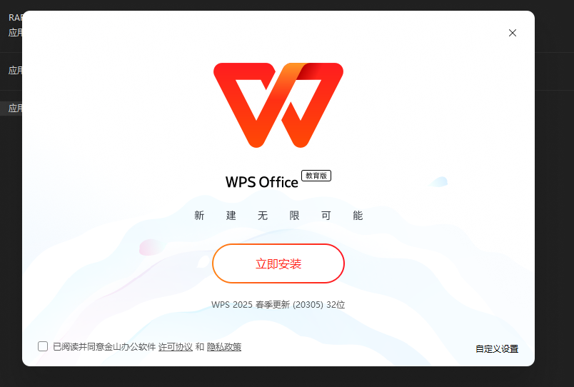

# WPS Office 教育版

> 面向教育办公场景的 WPS Office 版本，界面清爽无广告、无会员，办公功能免费使用，安装便捷。

## 🖼️ 安装界面

## ✨ 核心特点

| 特点 | 说明 |
| --- | --- |
| 🚫 **无广告** | 界面清爽，减少广告干扰，专注学习和办公 |
| 🆓 **无会员** | 办公功能免费使用，无需开通会员 |
| 🎓 **教育版** | 面向教育场景，方便师生开展日常办公 |
| 📄 **办公套件** | 支持文字、表格和演示等常见办公任务 |
| 🔗 **格式兼容** | 支持常见办公文档格式，方便交流与编辑 |
| ⚡ **安装便捷** | 下载对应安装包，按界面提示即可安装 |

## 📥 下载

安装包发布在 [Releases](https://github.com/HifumiDaisuki01/WPS-EducationEdition/releases) 页面：

- **2023 年版**：`教育专用版-WPS Office.exe`（较小）
- **2025 年版**：`WPS365Edu_office_12.1.0.20305_30.12013.exe`（较大）
- 适用平台：Windows

## 📝 使用说明

下载所需版本的安装包，双击运行并按提示完成安装。

## ⚠️ 声明

- 软件版权归金山办公所有，本仓库仅作资料存档与分享；
- 请在符合软件许可条款及相关法律法规的前提下使用。

## 🔗 相关项目

- [WPS 政企版（广东省省直机关单位）](https://github.com/HifumiDaisuki01/WPS-GovEdition)
